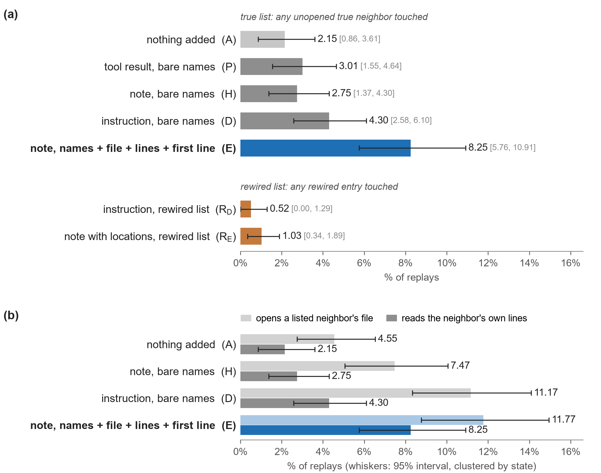
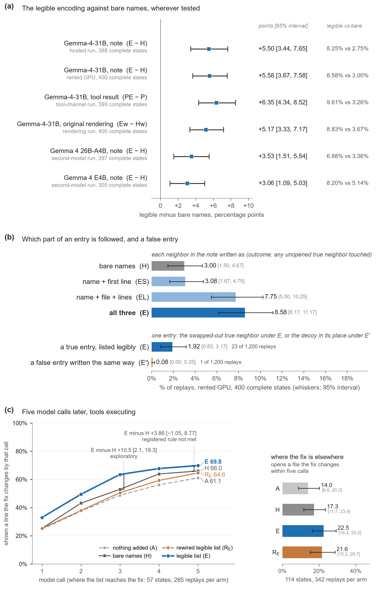
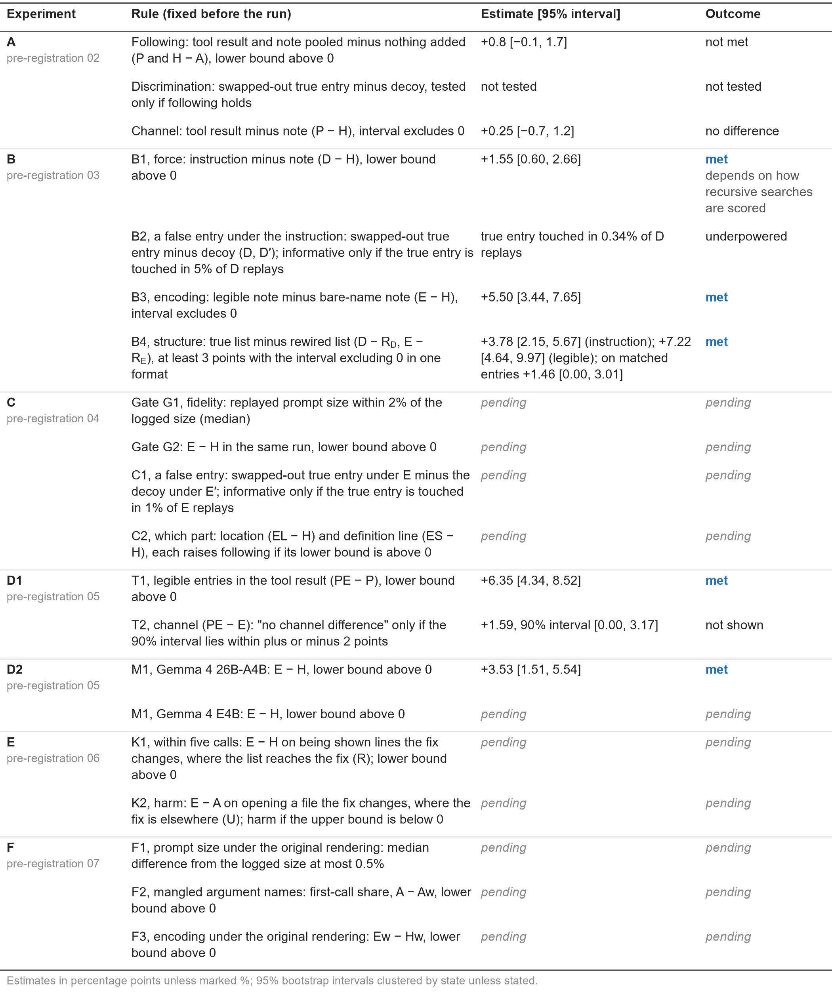

# Names get Gemma to the file, line ranges get it to the code

**Subtitle:** Pre-registered replays of paused agent runs show why the code graph goes unused, and what makes it used

<!-- DRAFT of Nov 10. Main text: Abstract to Reproducibility, at most 3,000 words (paper/wordcount.py). The host has
said that references do not count and that an appendix is supplementary. Remove this comment before submission. -->

## Abstract

A graph-localization skill barely changes what the competition's Gemma-4-31B agent resolves. We ask why, from inside the agent. We pause 205 real runs at 407 points right after the agent opens a file, show the model the code graph's neighbors of a function in that file, and replay its next step through the official harness: seven pre-registered experiments, about 40,000 replays. Bare names, as `get_code_neighbors` prints them, barely change the next call: 2.75% of replays reach a listed neighbor in an unopened file, against 2.15% with no list. The same neighbors with file and line range are followed three times as often (8.25%; +5.50 points, 95% interval 3.44 to 7.65). The gain holds inside the tool's own result (+6.35), on two other Gemma 4 models (+3.53, +3.06) and under the original harness's rendering (+5.17). The location carries all of it; the definition line adds nothing. A false neighbor written the same way is followed in 1 of 1,200 replays, the true one in 23. Five calls later the lead is +3.86 points [−1.05, 8.77]: the legible list gets the agent to the fix's lines sooner, not detectably more often. We also find that a harness change makes the 31B model mangle an argument name in about a third of its ranged reads, which then silently return the top of the file. Both problems are cheap to fix.

## 1. The question

The competition [1] ships a precomputed code graph of each repository and three tools to query it. The closest public entry, GraphLoc [2], found that a graph-localization skill moves the baseline agent's resolve rate from 28.9% to 29.9% (interval −4.1 to +6.3 points). An end-to-end score cannot say why. The agent may never ask the graph, ignore the answer, be unable to act on it as printed, or follow it to the wrong place.

We separate these at one step: we pause real runs, show the model the graph's neighbor list in one of several forms, and score its next call against the rate at which it would have gone to the same code anyway (Figure 1). We vary the channel (tool result or harness note), the force (information or instruction) and the encoding (bare names, or names with file, line range and first line). Two controls test the edges: one true neighbor swapped for a plausible false one, and a list from a degree-preserving rewiring of the graph. We then test the main effect inside the tool's own result, on two other Gemma 4 models, under the original harness's rendering of tool results, and over five calls with tools executing.

## 2. What the public traces already show

In the 318 base-agent traces GraphLoc published (3 runs of 106 tasks), by our count, the agent calls a graph tool in 109 runs and gets a non-empty answer in 26; `get_code_neighbors` is called 8 times, `get_code_subgraph` never. After a non-empty answer the next read or edit lands on a returned node 27% of the time, against 23% for random nodes from the same files: traces cannot tell steering from the agent's own direction, forks can. The graph holds every function or class the fix edits in 84% of tasks, but one hop from a function the issue names reaches fix code the issue does not already name in 10% (15% to 19% at two hops).

## 3. Method

### 3.1 States

A state is the message history of one real run, cut right after the first, second or third tool result that shows file content, before any edit and before compaction, with a logged prompt of at most 12,500 tokens. The queried node is a function or class the agent has already seen, with 2 to 50 graph neighbors. The rules were fixed in code before any replay and give 407 states from 205 runs of 77 tasks.

### 3.2 Arms

Every arm seeds the same history; only the last piece differs (Figure 1).

- **A** adds nothing.
- **P** inserts a `get_code_neighbors(node)` call and its result as the tool prints it: bare names.
- **H** gives the same list as a user-role note from the harness.
- **D** adds an instruction to read the neighbors not yet opened.
- **E** is H with each neighbor as name, file, line range and first line of its definition. **EL** keeps name, file and lines; **ES** keeps name and first line. **PE** puts E's entries inside P's tool result.
- **Controls.** P′, H′, D′ and E′ swap one true neighbor for a decoy: a real function from the same directory that is not a neighbor, a fix location or a test. R_D and R_E carry D's and E's text with a list from a degree-preserving rewiring of the graph.

**Figure 1.** The method, and the two list formats from one real state.

### 3.3 Replay

The history is loaded into the harness's own compiled agent as a session, and the arm's last piece is delivered as the new message. The agent makes one model call and stops; no tool executes. Each (state, arm) runs with seeds 1 to 3. In the five-call experiment, `read_file` and read-only shell commands execute through the harness's own tool functions on a checkout of the task snapshot, until any other call or the fifth model call.

**Fidelity.** Replays use harness v28, which hands tool results to the model as dictionaries; the original runs' harness handed them over as JSON strings [3]. Rebuilt the original way, the prompt is exactly 2 tokens below the logged size in 24 of 24 states, and the next call names the same tool as the real run in 83% of replays. Rebuilt as v28 renders it, the prompt is 1.7% smaller (median) and agreement is 76%. Every experiment uses v28's form unless stated.

### 3.4 Outcomes and rules

The outcome is the model's first function call. A listed node is touched when that call reads its file over a line range that overlaps the node (within the harness's caps of 150 lines and 10,000 characters per read), edits the file, or views it with a shell command that shows those lines or names the node. Only entries in unopened files are scored. Malformed calls are counted apart as interface failures. In the five-call experiment the outcome is whether the agent is shown a line the gold patch changes. Intervals are 95% bootstrap intervals clustered by state.

Six pre-registrations (`prereg/02` to `07`) fixed every decision rule by a commit before its run; Table 1 lists each rule with its outcome, met or not. Every registered number was re-derived by a second script written without the first. Runs used hosted L4 GPUs or rented A100s; no contrast mixes runs.

## 4. Results

### 4.1 One step

Ten arms, 12,210 replays; 388 states are complete in all arms (Figure 2a).

**Bare names barely move the next call.** With nothing added, 2.15% of replays reach a listed neighbor. The bare list gives 3.01% as a tool result and 2.75% as a note: +0.8 points pooled [−0.1, 1.7], so the registered following test was not met and discrimination could not be tested. The channel makes no difference (P − H +0.25 [−0.7, 1.2]).

**An instruction helps a little.** D − H is +1.55 [0.60, 2.66]; under a wider scoring of recursive searches it is +0.77 [−0.52, 2.06].

**A legible list is followed three times as often.** E reaches a listed neighbor in 8.25% of replays: E − H = +5.50 [3.44, 7.65]. E reaches one in 41 states and H in 14 (McNemar p = 5e-7). It holds in each seed, at each cut point, with either repository left out, clustered by task ([2.16, 9.15]) and under an independent recount.

**A rewired list is not followed.** Its entries are touched in 0.52% (R_D) and 1.03% (R_E) of replays. The registered structure rule is met (E − R_E +7.22 [4.64, 9.97]), with a qualification in Section 5.

**Figure 2.** (a) Share of replays whose next call reaches a listed neighbor, by arm. (b) Opening a listed neighbor's file against reading its lines.

### 4.2 The same effect in other settings

**Inside the tool's own result.** With E's entries as the result of the `get_code_neighbors` call itself, the next call reaches a listed neighbor in 9.61% of replays against 3.26% for the bare result: PE − P = +6.35 [4.34, 8.52] (Figure 3a). Note and tool result do not differ detectably (PE − E +1.59 [−0.33, 3.43]).

**Other models.** Two other Gemma 4 models continued the same histories. 26B-A4B follows the legible note in 6.88% of replays against 3.36% for bare names (+3.53 [1.51, 5.54]); E4B in 8.20% against 5.14% (+3.06 [1.09, 5.03]).

**Another platform, another rendering.** On a rented GPU the hosted contrast repeats (+5.58 [3.67, 7.58]). With every earlier tool result rendered as the original runs' harness did, it is +5.17 [3.33, 7.17].

**Figure 3.** (a) The legible list against bare names in six settings. (b) Parts of an entry, and a false entry. (c) Reaching the lines the fix changes, call by call.

### 4.3 Which part of an entry, and a false entry

**Location carries the effect.** The list with name, file and lines (EL) is followed in 7.75% of replays and the list with name and first definition line (ES) in 3.08%, against 3.00% for bare names and 8.58% for the full entry. EL − H is +4.75 [3.00, 6.58]; ES − H is +0.08 [−0.75, 0.92]. By the registered rule, location alone is sufficient for the full effect (E − EL +0.83, 90% interval [−0.17, 1.83]).

**A false entry is not followed.** In E′ a decoy takes the place of one true neighbor, written with its own file, lines and definition line. The true entry is followed in 23 of 1,200 replays and the decoy in 1 (+1.83 points [0.83, 3.17]). By the registered rule, the agent checks the edge.

### 4.4 Five calls later

2,968 replays continued for up to five model calls with reads executing. Where a listed neighbor lies in a file the fix changes (57 complete states), the agent is shown a line the gold patch changes in 69.8% of replays with the legible list, 66.0% with bare names and 61.1% with no list. The registered contrast, E − H, is +3.86 [−1.05, 8.77]: no detectable gain at five calls. Exploratory: the legible list gets there sooner (63.5% against 53.0% by the third call, +10.5 [2.1, 19.3]) and bare names catch up (Figure 3c).

Where the fix is elsewhere (114 states), the list does no harm: the fix's file is opened in 22.5% of replays with it and 14.0% without. A rewired list does the same (21.6%), so this gain is not the graph's content (Section 5).

**Table 1.** Every pre-registered rule and its outcome.

## 5. What the encoding changes (exploratory)

**Bare names already move the agent to the files.** Count a listed entry as followed by any means (its file opened at any lines, or its name or path used in a command): A is 5.2%, H 9.9%, D 12.9% and E 12.4% (H − A +4.64 [2.66, 6.79]).

**The encoding changes where in the file the read lands.** Given that the agent opens a listed entry's file, the read covers the entity 37% to 49% of the time in every arm except E, where it is 70% [56, 82]. In A, H and D all but three of 107 hits are a `read_file` from the top of the file, so an entity is reached only if it sits in the first 150 lines. In E, 47 of 96 hits start at a listed line. The pattern repeats in the tool channel (44% for P, 68% for PE) and on 26B-A4B (49% and 72%); it is weaker on E4B (47% and 55%).

**List position matters.** Per entry, E minus A is +4.1 points at rank 1, +1.7 at ranks 2 to 3, +1.0 at ranks 4 to 7 and +0.4 after that. The tool sorts alphabetically [4].

**The structure effect is smaller on matched entries.** The rewired entries were filtered to unseen names outside fix-location files; the scored true entries were not. With the true entries filtered the same way, E − H is still +2.32 [1.12, 3.69], but true minus rewired is +1.46 [0.00, 3.01]: most of the registered gap comes from true neighbors the agent has its own reasons to visit. Models differ in what they do with a rewired list: 26B-A4B touches its entries in 0.34% of replays with or without it, E4B in 2.84% against 0.66% (+2.19 [0.87, 3.83]).

**An interface defect.** In the replays the 31B model often writes a line bound under a mangled name, `start_line"`. The agent framework drops an argument name it does not know, so the read silently returns lines 1 to 150. A pre-registered test traces this to how tool results are rendered since the harness change of Sep 30, which turned them from JSON strings into dictionaries [3]: with no list, 36.1% of first-call reads that carry a line bound are mangled under the current rendering and 0.3% under the old one (18.3% against 0.2% of replays, +18.2 [14.8, 21.8]); the original runs had 1.0%. With tools executing, 14.4% of 4,655 ranged reads were mangled and 658 returned the file from line 1. The no-list arm is hit hardest (25% to 41% of its ranged reads, against 6% to 10% after a legible note), a likely reason any note helped in Section 4.4. The other two models never do it. Our registered outcomes do not depend on it (E − H +5.50 becomes +5.58 with the bound honored).

## 6. What it means

Where these agents decide where to look, the graph's failure is not a failure to attend or to tell a true edge from a false one. The tool prints names. A name gets the agent to a file, which it reads from line 1 under a 150-line cap. A file and a line range get it to the code: three times as often at the next call, ten points more often by the third, and not detectably more often by the fifth. What a legible graph buys this agent is calls.

Three changes follow; none needs training:

1. `get_code_neighbors` should return each neighbor's file and line range. The definition line can be left out.
2. The harness should reject an unknown argument name instead of dropping it, so the model can retry. As it stands, a third of the 31B model's ranged reads after a file read return the wrong lines.
3. The list is alphabetical and following falls with rank. An order by relevance is untested.

Legible output did not make wrong edges actionable for the two larger models; the smallest one does follow a rewired list.

## 7. Related work

How a graph is written as text changes what a language model does with it on static graph tasks [5, 6]; we ask that question inside an agent's loop. The nearest study is a pre-registered, placebo-controlled scale study of how much code-graph and embedding tools help small agents localize code [7]. Its graph tool already prints signatures and paths, and its arms vary the tool set, not the encoding; its placebo replaces every returned entity with a random one for whole episodes, scored by final localization. Its first version reports that forcing the graph call does not help and that agents expand once and stop [8]. LocAgent compares six text formats of its graph tool's output [9]; LARGER appends callers and callees to grep output and never varies the encoding [10]; RepoNav attributes localization gains to how retrieved snippets are organized [11]; others compare repository views [12] and tool architectures [13]; a same-track entry finds that adding call edges to a signature map does not help [14]. That output format changes agent behavior is therefore known.

On trust: pushed corrupted search results are adopted more than tool-returned ones on this model [15]; a harness-inserted tool result is trusted like a real call [16]; small agents copy a graph-learning tool's often wrong labels [17]. Fork designs exist for tool results in scientific question answering [18] and after compaction [19, 20].

Within the competition, GraphLoc asks whether this graph helps localization and repair [2] and GraphAudit whether it helps retrieval, with the rewiring control we borrow [21]. Forum posts audit the graph tools [4] and compare three encodings of a file read on 30 fixed edit contexts [3], a small precedent for our method.

In what we searched (`docs/lit/`), no work fixes one function's graph neighbors at a paused agent state, varies only their encoding or rewires them with degree preserved, and scores the next action against a no-list base rate.

## 8. Limitations

We measure where the agent looks, not whether it fixes the task. No run here is scored by tests, and by the fifth call the legible list's lead is not detectable. The five-call replays are read-only and end at the first edit; 49 of them overflowed the context, which the real agent avoids by compaction. States come from the 31B agent's runs on two repositories, and the other models continue its histories, not their own. One harness version, in two renderings of tool results. The hosted arms ran in three sessions; arm E was rerun twice on another platform (8.0% and 8.6% against 8.25%). The instruction effect depends on how recursive searches are scored. The decoy is plausible, not adversarial. The interface defect is measured in replays of earlier histories under the current harness, not in fresh runs.

## Reproducibility

Code, the six pre-registrations with their commit times, the raw outputs of all nine runs, the independent re-derivations and the figure code are released under Apache 2.0 at [repository URL]. `analysis/reproduce.py` re-runs every analysis from the raw outputs and compares it with the stored result. The competition data is not redistributed; the state bundle is rebuilt from it by the exporter. The appendix lists the rules as text, the runs, robustness checks and every deviation.

## References

[1] Markowitz, Perozzi, Rózemberczki, Cameron, Hemmati, Li, Galkin, Farhadi, Holbrook, Oldacre. Google - The Gemma 4 Developer Agent Paper Track. Kaggle, 2026. https://www.kaggle.com/competitions/gemma-4-developer-agent-paper

[2] GraphLoc: Where Does the Graph Help? A Localization Audit of the Gemma 4 Developer Agent Code Graphs. Kaggle writeup and notebooks (user zzgtylors), same track, Sep 2026. https://www.kaggle.com/code/zzgtylors/graphloc-auditing-gemma-4-agent-code-graphs

[3] Tool results reach the model double-JSON-encoded. Discussion 744272 with replies, Gemma 4 Developer Agent Competition, Kaggle, Sep 2026. https://www.kaggle.com/competitions/gemma-4-developer-agent/discussion/744272

[4] Notes on the graph tools from auditing all 127 graphs. Discussion 745731, Gemma 4 Developer Agent Competition, Kaggle, Oct 2026. https://www.kaggle.com/competitions/gemma-4-developer-agent/discussion/745731

[5] Fatemi, Halcrow, Perozzi. Talk like a Graph: Encoding Graphs for Large Language Models. ICLR, 2024. arXiv:2310.04560

[6] Markowitz et al. KG-LLM-Bench: A Scalable Benchmark for Evaluating LLM Reasoning on Textualized Knowledge Graphs. arXiv:2504.07087, 2025

[7] Bellam. How Much Do Structural Tools Help Small Coding Agents? A Pre-Registered Scale Study of Code Localization. arXiv:2610.33958v2, 2026

[8] Bellam. How Do Small Coding Agents Use Code Graphs and Embeddings? arXiv:2610.33958v1, 2026

[9] Chen et al. LocAgent: Graph-Guided LLM Agents for Code Localization. ACL, 2025. arXiv:2503.09089 (Appendix A.1.2)

[10] Hu, Su, Zhao, Zhu, Haque. LARGER: Lexically Anchored Repository Graph Exploration and Retrieval. arXiv:2605.16352, 2026

[11] Chai et al. RepoNav: From Snippet Retrieval to File-Centered Repository Navigation for Code Agents. arXiv:2609.08355, 2026

[12] Sepidband et al. How Should Agents See Code? Rethinking Code Representations for Agentic Software Engineering. arXiv:2611.07286, 2026

[13] Xu et al. The Devil Is in the Interface: Evaluating How Tool Architecture Shapes Coding Agent Behavior. arXiv:2608.11386, 2026

[14] Muhammad. AST-Compressed Code Graphs for Gemma 4 Agents: What a Small Local Model Gains from a Budgeted Repository Map. Zenodo, 2026. doi:10.5281/zenodo.23927441

[15] Yang et al. Agents' Overreliance on Unreliable Tools. arXiv:2609.05587, 2026

[16] Kereopa-Yorke et al. Oracle Poisoning: Corrupting Knowledge Graphs to Weaponise AI Agent Reasoning. arXiv:2605.09822, 2026

[17] Wang, Vemuri. When the Tool Decides: LLM Agents Defer Blindly to Graph Neural Network Tools, and Stronger Backbones Defer More. arXiv:2606.14476, 2026

[18] Zhang et al. Same Simulation, Different Evidence: Where Retrieved Tool Output Costs LLM Agents Accuracy. arXiv:2610.26836, 2026

[19] Min et al. Adapting Context Compression for Long-Horizon Agents with Counterfactual Continuations. arXiv:2609.36526, 2026

[20] Sun et al. Compact-Bench: Measuring What Context Compaction Costs Long-Horizon Coding Agents. arXiv:2610.31710, 2026

[21] GraphAudit. Kaggle writeup in the same track, read in full on Oct 27, 2026 (hidden since submission; author and URL not recorded).

## Appendix

Supplementary material. Every number here is printed by a script in the repository from the raw replay outputs (`analysis/reproduce.py` lists them).

### A. Pre-registered rules and outcomes (text form of Table 1)

| Pre-registration | Rule, fixed before the run | Estimate [95% interval] | Outcome |
|---|---|---|---|
| 02 | Following: P and H pooled minus A, lower bound above 0 | +0.8 [−0.1, 1.7] | not met |
| 02 | Discrimination: swapped-out true entry minus decoy, tested only if following holds | | not tested |
| 02 | Channel: P minus H | +0.25 [−0.7, 1.2] | no difference |
| 03 | B1, force: D minus H, lower bound above 0 | +1.55 [0.60, 2.66] | met; not under a wider scoring of recursive searches (+0.77 [−0.52, 2.06]) |
| 03 | B2, false entry under the instruction: informative only if the true entry is touched in 5% of D replays | 0.34% | underpowered |
| 03 | B3, encoding: E minus H, interval excludes 0 | +5.50 [3.44, 7.65] | met |
| 03 | B4, structure: true list minus rewired list at least 3 points with the interval excluding 0, in one format | +3.78 [2.15, 5.67] (D); +7.22 [4.64, 9.97] (E) | met; on matched entries +1.46 [0.00, 3.01] |
| 04 | Gate G1: replayed prompt size within 2% of the logged size (median) | 1.66% | passed |
| 04 | Gate G2: E minus H in the same run, lower bound above 0 | +5.58 [3.67, 7.58] | passed |
| 04 | C1, false entry: true entry under E minus decoy under E′; "checks the edge" if the lower bound is above 0 and the decoy rate is under half the true entry's | 23 against 1 of 1,200 replays; +1.83 [0.83, 3.17] | met: checks the edge |
| 04 | C2, parts: a part raises following if its arm minus H has a lower bound above 0; it is sufficient if the 90% interval of E minus that arm lies within 2 points | EL − H +4.75 [3.00, 6.58]; ES − H +0.08 [−0.75, 0.92]; E − EL +0.83, 90% [−0.17, 1.83] | location carries it and is sufficient |
| 05 | T1: PE minus P, lower bound above 0 | +6.35 [4.34, 8.52] | met |
| 05 | T2: "no channel difference" only if the 90% interval of PE minus E lies within 2 points | +1.59, 90% [0.00, 3.17] | not shown |
| 05 | M1, Gemma 4 26B-A4B: E minus H, lower bound above 0 | +3.53 [1.51, 5.54] | met |
| 05 | M1, Gemma 4 E4B: the same | +3.06 [1.09, 5.03] | met |
| 06 | Gate: at least 95% of re-executed file reads identical to the logged ones | 44 of 44 | passed |
| 06 | K1: E minus H on being shown a changed line within five calls, where the list reaches the fix; lower bound above 0, robust only if also by task | +3.86 [−1.05, 8.77]; by task [−0.80, 9.63] | not met |
| 06 | K2, harm: E minus A on opening a changed file, where the fix is elsewhere; harm if the upper bound is below 0 | +8.48 [3.22, 14.04] | no harm |
| 07 | F1: prompt size under the original rendering within 0.5% of the logged size (median) | 0.03% (2 tokens in 24 of 24 states) | met |
| 07 | F2: first-call reads with a mangled line-bound name, A minus Aw, lower bound above 0 | +18.17 [14.75, 21.75] | met |
| 07 | F3: Ew minus Hw, lower bound above 0 | +5.17 [3.33, 7.17] | met |

Aw, Hw and Ew are arms A, H and E on a history whose earlier tool results are delivered as the original runs' harness delivered them.

### B. Runs

| Run | Arms | Replays | Model and platform | Complete states | Interface failures |
|---|---|---|---|---|---|
| Hosted 1 | A, P, P′, H, H′ | 6,105 | Gemma-4-31B (QAT, 4-bit), four L4, 4.1 h | 388 across the three hosted runs | 34 across the three (24 malformed, 10 no call) |
| Hosted 2 | D, D′, E | 3,663 | same, 3.0 h | | |
| Hosted 3 | R_D, R_E | 2,442 | same, 2.3 h | | |
| Parts and false entry | E′, EL, ES, E, H | 6,105 | 31B, one A100-80GB, 3.6 h in two containers | 400 | 12 |
| Tool channel | P, PE, E | 3,663 | 31B, one A100-80GB, 1.9 h | 399 | 11 |
| Second model | A, H, E, R_E | 4,884 | Gemma 4 26B-A4B, one A100-80GB, 1.6 h | 397 | 20 |
| Second model | A, H, E, R_E | 4,884 | Gemma 4 E4B, one A100-80GB, 2.7 h | 305 | 326, nearly all malformed `edit_file` calls |
| Five calls | A, H, E, R_E | 2,968 | 31B, one A100-80GB, 4.6 h | 57 of 74 and 114 of 124 | 49 context overflows, 2 malformed |
| Rendering | A, Aw, Hw, Ew | 4,884 | 31B, one A100-80GB, 2.6 h | 400 | 10 |

39,598 replays in all, seeds 1 to 3 (1 to 5 in the five-call experiment where the list reaches the fix). Every run installed harness v28 (adk_eval_core 0.1.0, adk_submission 0.2.12, swegemma 0.2.7), google-adk 1.36.1 and vLLM 0.19.1; each run's `versions.json` also lists the newer wheels that sit unused in the wheelhouse, and its `pip_freeze.txt` shows what was installed. The rented runs used Modal, Python 3.12.1, tensor-parallel size 1 and torch 2.10.0 (hosted: tensor-parallel size 4, torch 2.10.0+cu128), with the model served under the hosted path so the model name the agent sees is identical. On the 24 fidelity states the rented platform reproduces the hosted prompt sizes token for token. The second models are unquantized and continue the 31B agent's histories.

### C. Robustness of the one-step result

- **Independent recount.** A second script, written without the first, rescored all 46,560 (replay, entry-class) cells of the 388 complete states from the raw replay logs. Under the reading closest to the registered grep rule it differs in 28 cells, all shell searches, and every decision stands (B1 +1.55 [0.43, 2.75], B3 +5.33 [3.35, 7.30], B4 +4.04 and +7.22). Under a wider reading that also credits recursive searches over a directory that contains an entry's file, base rates rise (A 3.5%, E 9.1%), B3 and B4 stand (+4.73 [2.75, 6.70]; +4.47, +7.90) and B1 does not (+0.77 [−0.52, 2.06]).
- **Clustering and concentration.** Clustered by task instead of state, E − H is +5.50 [2.16, 9.15] and E − R_E +7.22 [2.97, 12.07]. By McNemar's test on states (any of three seeds), E reaches a listed neighbor in 41 states and H in 14 (29 against 2 discordant, p = 5e-7). E − H is positive in each seed, at each cut point, with either repository left out (+3.1, +7.7) and with any single task left out. Without the five tasks with the most E hits it is +2.4 to +2.7, depending on a tie for fifth place (+2.37 [0.85, 4.07] at the low end).
- **Sessions and platforms.** No hosted arm ran in two sessions. True entries that an arm does not show are touched at the same rate in two of the three sessions (R_D − A +0.17 [−0.86, 1.29]; R_E − A +0.26 [−0.60, 1.12]). On the rented platform arm E gives 8.02% and 8.58% in two runs against 8.25% hosted; paired on the same states and seeds the drift is +0.58 [−0.41, 1.57] for E and +0.25 [−0.33, 0.82] for H.
- **Matched entries.** 3,292 of the 3,704 scored true entries pass the filter the rewired entries passed. On them E is 2.49% [1.20, 3.87], E − H +2.32 [1.12, 3.69], true minus rewired +1.46 [0.00, 3.01] under E (lower bound −0.09 in an independent bootstrap) and +0.34 [−0.60, 1.29] under D. Five of R_E's 12 hits start at a listed first line. 847 rewired entries in 298 states are same-directory padding, not rewired edges.
- **Thoughts.** A fresh true neighbor is named in the model's thoughts in 10.8% of H replays, 12.2% of D and 11.0% of E (E − H +0.21 [−1.00, 1.53]): the model notices the names equally.
- **Toward the fix at one step.** Counting only `read_file` calls on an unopened file that holds a fix location, the next call goes there in 6.0% of A replays, 6.6% of H, 8.8% of D and 8.2% of E (E − A +2.15 [0.60, 3.95]); counting any read, edit or shell view of a file the gold patch changes, 6.9%, 7.2%, 9.4% and 8.5% (E − A +1.63 [−0.26, 3.61]).
- **Prompt length.** The legible note costs about 620 prompt tokens over the bare one, the location-only note about 400 and the definition-only note about 270.

### D. Interface failures

Malformed calls, calls to unknown tools and responses without a call are excluded from every estimate and counted in table B.

**Mangled line-bound names** (exploratory except the rendering run, which is pre-registration 07). A name is mangled if it is not a plain identifier and reads `start_line` or `end_line` once quotes, backslashes and spaces are removed. The agent framework keeps only arguments that are parameters of the tool (`google/adk/tools/function_tool.py`), so the bound is dropped and the tool returns the file from line 1.

| Setting | Arm | First-call reads with a line bound | With a mangled name |
|---|---|---|---|
| Hosted, 31B | A | 589 | 211 (35.8%) |
| | P | 481 | 83 (17.3%) |
| | H | 504 | 69 (13.7%) |
| | D | 571 | 82 (14.4%) |
| | E | 634 | 31 (4.9%) |
| | R_D | 522 | 77 (14.8%) |
| | R_E | 508 | 24 (4.7%) |
| Tool channel, 31B | P | 460 | 77 (16.7%) |
| | PE | 585 | 36 (6.2%) |
| | E | 636 | 28 (4.4%) |
| Rendering run, 31B | A, current rendering | 610 | 220 (36.1%) |
| | Aw, original rendering | 595 | 2 (0.3%) |
| | Hw | 501 | 7 (1.4%) |
| | Ew | 631 | 1 (0.2%) |
| Gemma 4 26B-A4B | four arms | 2,572 | 0 |
| Gemma 4 E4B | four arms | 1,466 | 0 |
| Original runs, their own next call at the same states | | 201 | 2 (1.0%) |
| Original runs, all 318 base traces | | 2,012 | 42 (2.1%), each returned the file from line 1 |
| Five calls with tools executing, 31B | four arms, every call | 4,655 | 668 (14.4%); 658 returned the file from line 1 |

Under the current rendering the mangled name is `start_line"`; under the original rendering it carries a backslash, as in the original runs. In the five-call experiment the rate is 40.6% at the first call and 25.1% at later calls with no list, 22.2% and 9.4% after the bare note, 6.3% and 9.6% after the legible note, 9.0% and 6.9% after the rewired note. With the mangled bound honored, hosted E goes from 8.25% to 8.33%, every bare-name arm is unchanged, and E − H goes from +5.50 to +5.58; in the tool channel PE − P goes from +6.35 to +6.77. Reads of a listed unopened file under bare names carry a mangled bound in 1 of 577 cases, so opening the file from the top is the model's own choice there.

### E. The five-call experiment

Populations were fixed from facts known before any replay. R: a listed neighbor in an unopened file lies in a file the gold patch modifies (74 states, 20 tasks, seeds 1 to 5). U: not in R, and a file the gold patch modifies is unopened (124 states, 30 tasks, seeds 1 to 3). A state counts if every arm and seed gave a usable replay. Allowed calls are `read_file` and read-only shell commands (cat, head, tail, sed -n, grep, rg, ls, find, wc and pipelines of these); a search never counts as being shown a line. All 198 checkouts were unchanged after their replays. On the platform, 44 of 44 logged file reads re-executed identically; of 67 logged shell results, 36 were identical, 18 had the same lines in another order and 13 differed.

Shown a line the gold patch changes by the end of each call, R, percent of replays:

| By call | No list (A) | Bare names (H) | Legible (E) | Rewired legible (R_E) | E − H |
|---|---|---|---|---|---|
| 1 | 24.6 | 25.3 | 33.0 | 25.3 | +7.7 [0.7, 15.8] |
| 2 | 37.5 | 43.2 | 49.5 | 37.9 | +6.3 [−0.4, 14.0] |
| 3 | 48.8 | 53.0 | 63.5 | 50.5 | +10.5 [2.1, 19.3] |
| 4 | 56.1 | 63.9 | 67.7 | 59.3 | +3.9 [−1.4, 9.1] |
| 5 | 61.1 | 66.0 | 69.8 | 64.6 | +3.9 [−1.1, 8.8], the registered contrast |

Only the last row is a registered rule. In U, within five calls, a file the gold patch changes is opened in 14.0% (A), 17.3% (H), 22.5% (E) and 21.6% (R_E) of replays, and a changed line is shown in 10.2%, 13.2%, 15.2% and 15.8%. About two thirds of replays reach the fifth call; the rest stop at an edit (11% to 13%), a file write (11% to 13%), a shell command that is not read-only (7%), a graph tool (2% to 4%) or a text answer. A sensitivity analysis written before any outcome was read keeps the 49 overflowed replays and scores the calls that executed: K1 becomes +1.92 [−2.47, 6.58] and K2 +7.53 [2.69, 12.90].

### F. Deviations and amendments

1. Pre-registration 03 says the true and the rewired entries pass the same filter; the code filtered only the rewired ones. Found on Nov 9 after the runs; Section 5 and Appendix C report the matched contrast.
2. The instruction rule (B1) is met under the registered scorer and not under a wider reading of recursive searches (Appendix C).
3. An earlier hosted run re-sent the agent's past thoughts, failed the fidelity gate (6.1%) and is reported only in the project log.
4. Pre-registration 05 named Gemma 4 12B as the second model. The pinned server cannot load its architecture, so no replay ran; an amendment made before any second-model replay names 26B-A4B and E4B and requires both to be reported.
5. Pre-registration 06 was amended before its full run: 16 replays in flight and a 9-hour budget. The run finished in 4.6 hours, so no replay was cut.
6. The run of pre-registration 04 was preempted by the platform after 2,946 saved replays and resumed by itself in a second container from the same fixed order.
7. The supplement to the five-call analysis (failures by arm, clustering by task, the sensitivity above) was written while the run was in progress, after its error messages had been read and before any outcome was read. The rendering experiment was designed after the mangled names were noticed in the earlier runs and registered before any replay of its new arms. The commits carry the times.
8. Every result of pre-registrations 04 to 07 comes from one run per model; none was repeated.

### G. Wording of the notes

- **H:** `Code graph note from the harness. get_code_neighbors(node="...") returned:` followed by the tool's JSON, `{"status": "ok", "node": "...", "neighbors": ["pkg.mod.name", ...]}`.
- **D:** `Instruction from the harness. Before you edit anything, look at the code graph neighbors of "..." below and read the ones you have not opened yet.` followed by the same JSON.
- **E:** H's sentence, with each neighbor as `{"name": "pkg.mod.name", "file": "pkg/mod.py", "lines": "272-278", "def": "def name(...) -> ...:"}`. EL drops `def`; ES drops `file` and `lines`.
- **P and PE:** the same JSON, bare or legible, as the result of an inserted `get_code_neighbors` call.

