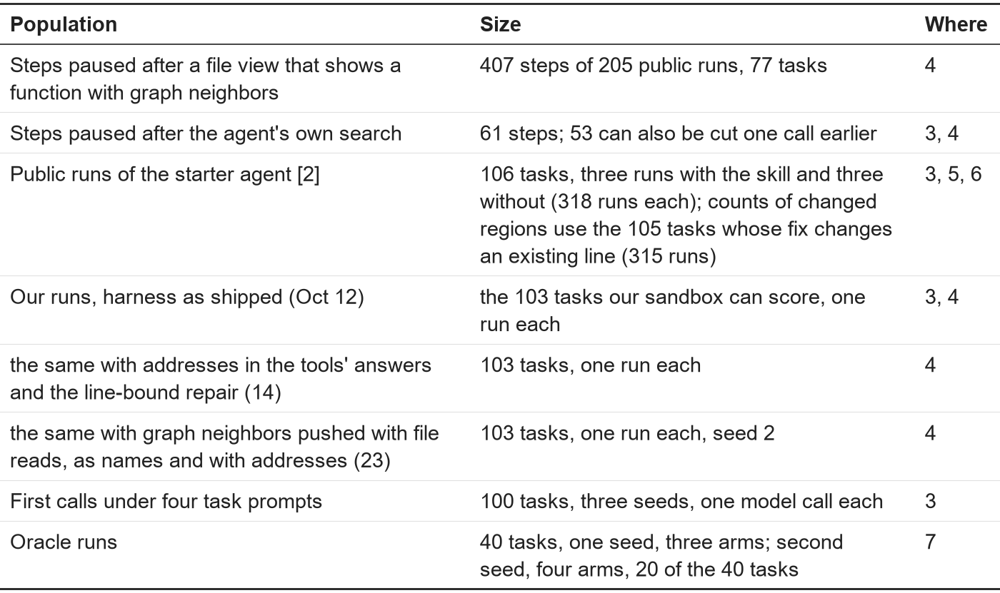
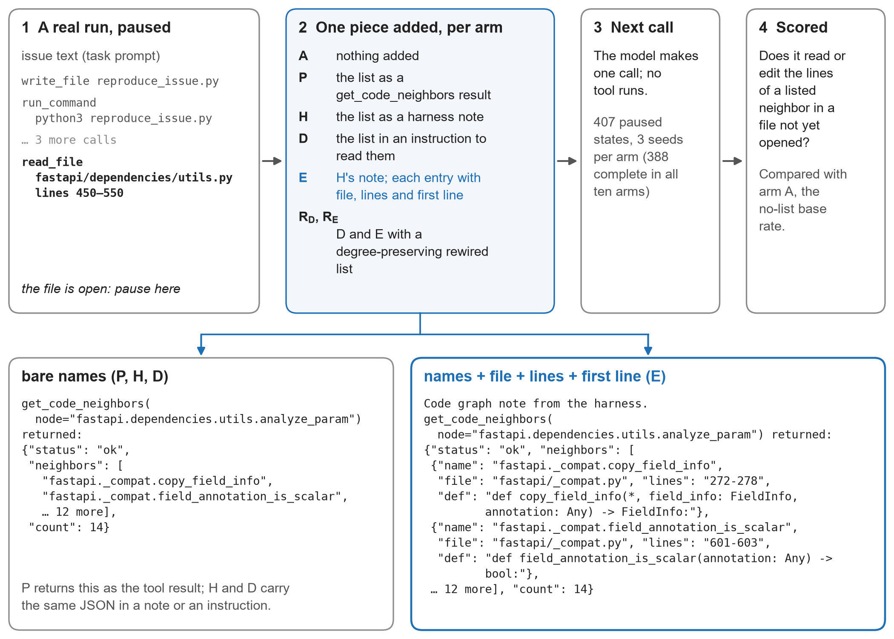
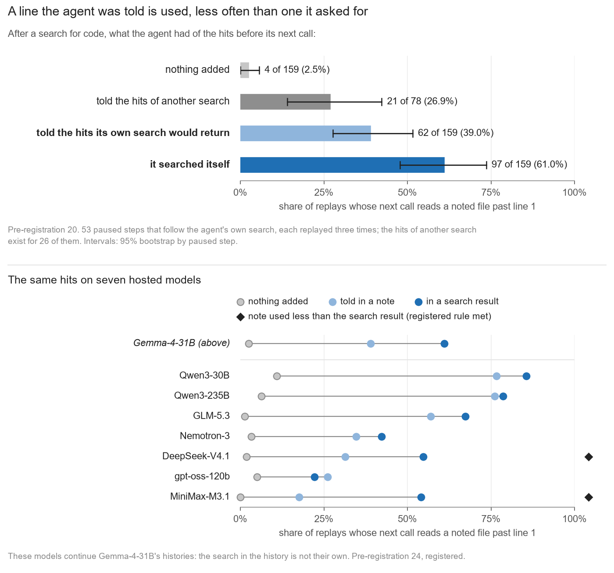
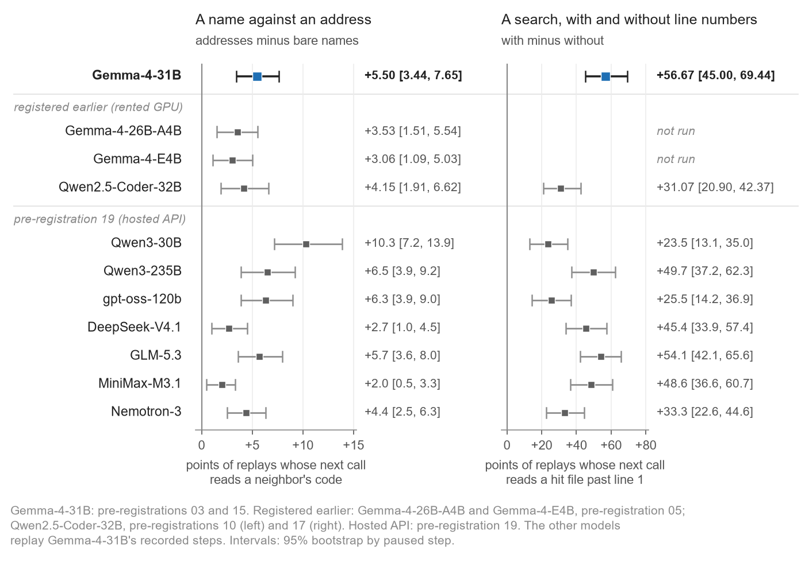
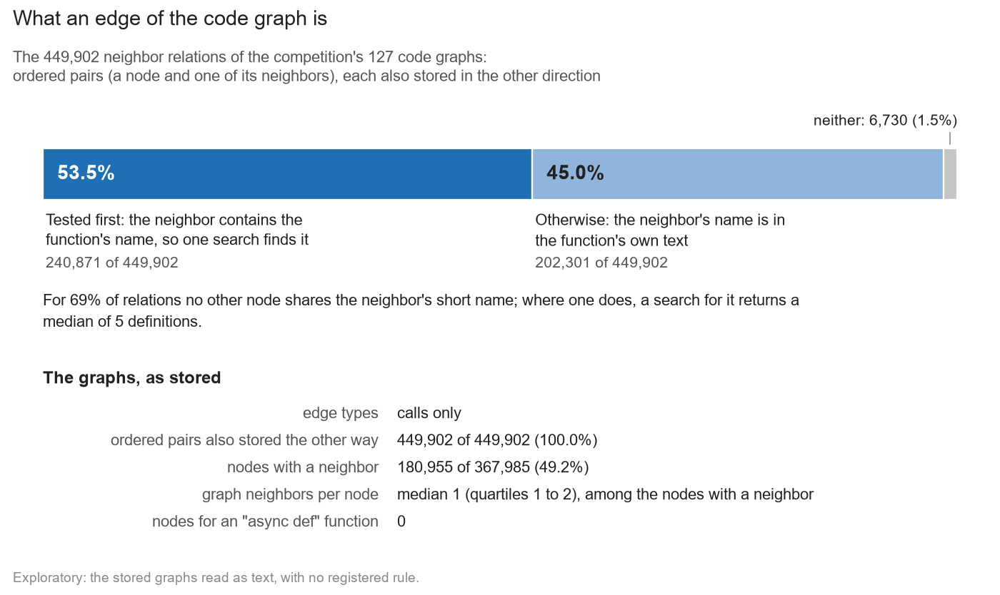
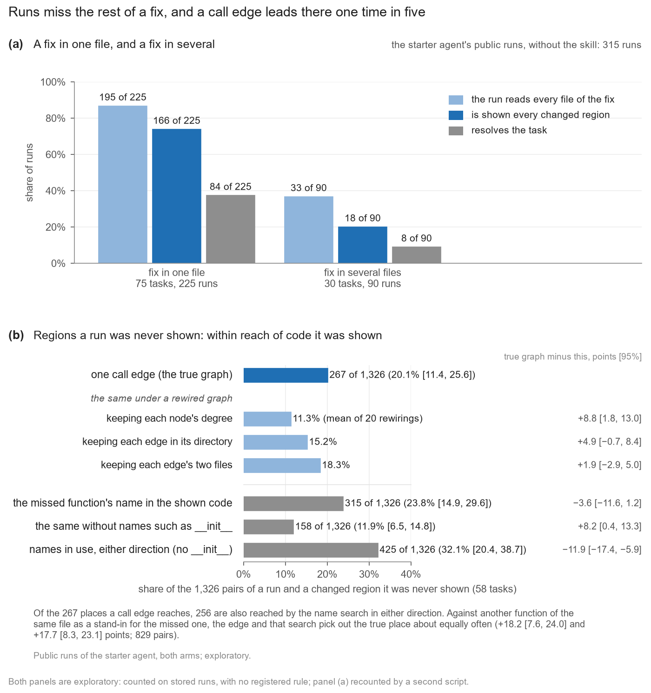
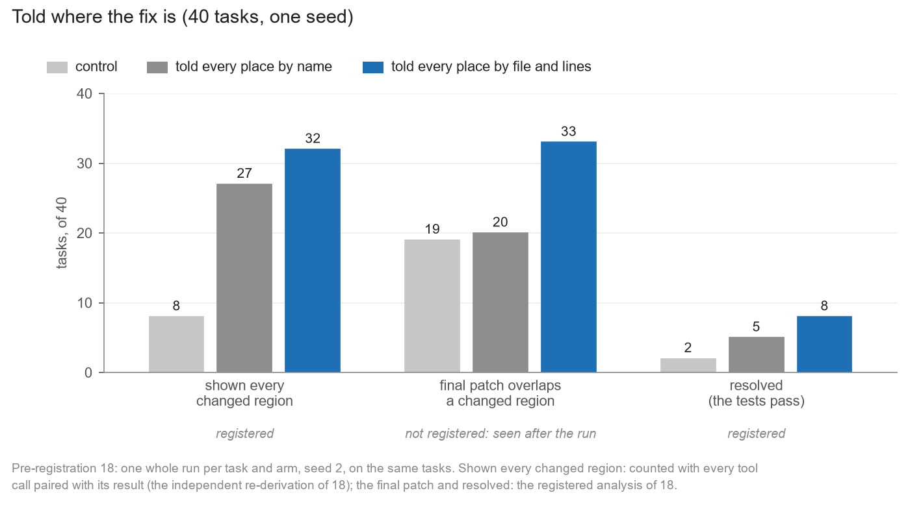
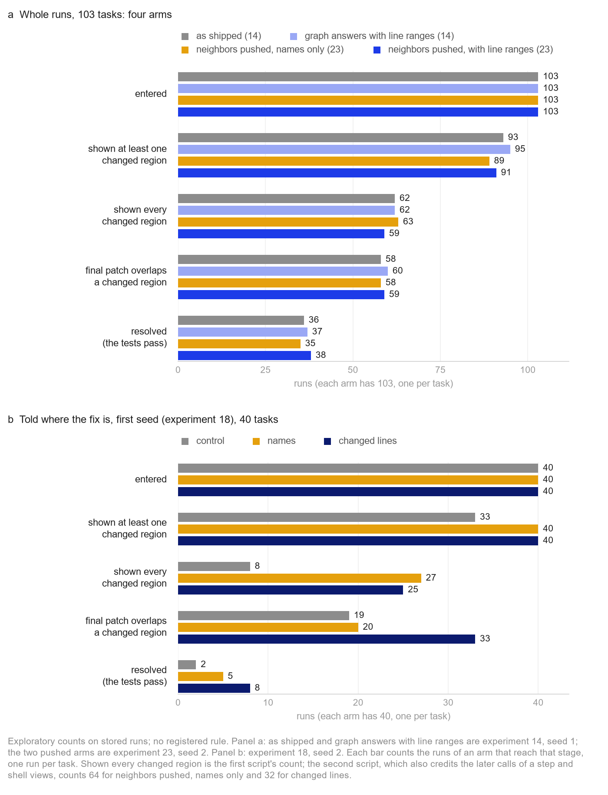
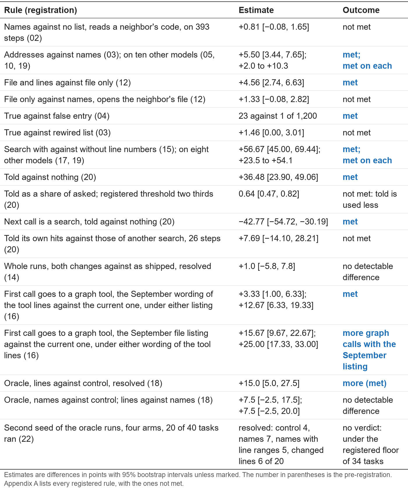

# A name is not an address, and an address is not enough

**Subtitle:** What a coding agent does with a code graph's answers, and why they have not helped

## Abstract

The Gemma 4 developer agent comes with a code graph and tools that query it, yet no public test we know of shows the graph raising the number of solved tasks. We find out why by replaying real agent runs: we pause a run at a tool result, change one message, record the agent's next call, and then test the change in whole runs. Each experiment's rules were committed before it ran (exceptions: Appendix F). First, the agent acts on line numbers, and the graph tools give it none: with a file and line range beside each name, the agent follows a graph answer three times as often (8.25% against 2.75% of replays; registered, and replicated on other models). Second, place matters: the same list is followed in 6.65% of steps as a separate note after a file view and in 1.90% inside it (registered). The gap holds on three of seven other models, and on five once the system prompt tells the agent to use such lists, an instruction that raises uptake inside the view on only one (registered). This can explain why lists inside file reads changed nothing we could detect in whole runs (38 against 35 of 103 tasks resolved; registered). Third, the answers seldom arrive: the current task prompt cut the agent's first calls to a graph tool from 29% to under 1% (registered). Fourth, location is not enough: told the lines a fix changes, the agent still fails most tasks. We release the replay suite, with its registrations and blind second scripts: any tool answer, at paused steps, on any model behind an API, for a few dollars.

## 1. The question

The competition [1] gives every agent a code graph of the repository and three tools to query it, but the graph has not yet shown that it helps. In the public runs of GraphLoc [2], the starter agent resolved 95 of 315 scored runs with a skill that ranks locations from the graph and 92 of 315 without. Other entries find that expanding along its edges retrieves code no better than matching words [3–6], that appending the nodes nearest the issue leaves resolved tasks unchanged [7], and that the graph tools change nothing detectable [8].

How a graph is written as text changes what a language model *answers* about it [9–11]. We ask what it changes in what an agent *does*. We test each change first at single steps, where an effect is cheap to find, then in whole runs, where it counts. We found no earlier test that varies a tool's output format at both levels. We follow a tool's answer to the agent's next action, one step per finding (changes for builders: Section 8):

1. **Does the answer arrive?** Rarely: today's task prompt nearly stops the agent from calling the graph at its first call (Section 3).
2. **What does it say?** Names, but the agent acts on line numbers: with a file and line range beside each name, it follows a graph answer three times as often (Section 4).
3. **Where does it sit?** The same list is followed far more often as a separate note than inside a file view, on several models and despite an instruction to use such lists (Section 4).
4. **Does the graph know more than names?** Its edges mostly link names, and call edges are no detectably better guide to missed code than file pairs (Sections 5 and 6).
5. **Is location enough?** No: told the exact lines of a fix, the agent still fails most tasks (Section 7).

## 2. Method

**Replay.** A paused step is the history of a recorded run up to one of its tool results. Our replay suite loads it into the harness's compiled agent, adds or changes one message, and lets the agent make one model call; no tool runs (Figure 1; after [12–14]; a concurrent track entry probes paused runs the same way [15]). Each condition is sampled up to three times at the starter agent's settings. The paused steps come from September's public runs (harness release of Sep 30); whole runs use the release of Oct 12.

**Populations.** The public runs cover 106 of the 129 public tasks; 103 of them, and all our runs, are from fastapi and rich (Table 1). Each comparison uses only the steps scored in every condition (Appendix B).

**Table 1.** The populations.

**Outcomes.** At a replayed step, the outcome is whether the next call *reads a neighbor's code*: reads, views, searches or edits lines of a listed neighbor in a file the agent has not opened (registered). This outcome favors answers with line numbers, because a read without a range returns a file's first 150 lines, so beside it we report whether the agent *opens the file* at all (exploratory). In whole runs, a run is *shown* a *changed region* (a hunk of the reference patch) when a file read returns one of its lines, and the task's tests decide whether it is *resolved*.

**Rules.** Before each experiment we committed its decision rules (*registered*; exceptions: Appendix F). A rule is *met* when the 95% bootstrap interval of its difference lies on the registered side of zero. Otherwise we write *not met*, or *no detectable difference* where no side was registered; either may mean only that the test could not decide. A second script, written without seeing the first, recomputed every registered result except the first registration's. Every registered result is reported, forecasts that failed included: Table 2 lists the rules reported here, Appendix A all of them, Appendix K those of 26 and 27; everything else is marked exploratory.

**Figure 1.** A paused step, the one message that differs between conditions, and the outcome.

## 3. The graph's answers seldom reach the agent

**Called, but rarely answered (exploratory).** In September's public runs without the skill, the agent called a graph tool in 109 of 318 runs (34%). It nearly always called `search_similar_code` first, which came back empty for 114 of its 135 calls (also [16, 17]). Only 26 of the 318 runs ever received a non-empty graph answer. The October release repaired this [18].

**The current prompt (registered).** At the first model call of 100 tasks, 29% of calls go to a graph tool under September's task prompt and under 1% under the current one. Two of the prompt's changes each matter: its listing of the workspace's files and its wording of the tool lines (Table 2).

**Handed over instead (registered).** At 53 steps paused just before the agent searches for code, we handed it the hits that search was about to return, in a *note*: a separate message (Figure 2). Without the note, its next call reads a noted file past line 1 in 2.5% of replays; with the note, in 39% (met). Searching itself, it reads one in 61% of replays, one call later. Handed hits are used 0.64 times as often as searched ones [0.47, 0.82], an interval that contains the registered mark of two thirds (not met; undecided).

**Figure 2.** The same search hits, searched for or handed over.

## 4. The answers are names, and the agent acts on line numbers

`get_code_neighbors` answers with dotted names such as `pkg.mod.f`; an address adds `pkg/mod.py, lines 120-148`. We replayed 388 steps three ways: with no list, with the names, and with *addresses*, each name followed by its file, line range and definition line.

**Addresses triple the uptake (registered).** The next call reads a neighbor's code in 2.15% of 1,164 replays with no list, 2.75% with names and 8.25% with addresses. Addresses against names is met (+5.50 points [3.44, 7.65]), and met again on the October release (+5.6 [3.8, 7.8]).

**The line range does it, not the format (registered).** At the same steps, file and range alone give 7.7% of replays and the file alone 3.2% (+4.6 points [2.7, 6.6]; met). Neither the definition line nor the format adds anything detectable (Table 2).

**The agent's own search behaves the same way (registered).** At 60 steps where the agent has just searched and the result names an unopened file with line numbers, its next call reads that file past line 1 in 62% of replays; with the numbers stripped, in 5% (met). Without numbers it still opens the file, but reads it from the top (exploratory). The name gets the file opened; the number gets the line read.

**On other models.** Both effects hold when other models continue the same steps (Figure 3): addresses against names on ten models (+2.0 to +10.3 points; on nine with tasks resampled), line numbers in search results on eight (+23.5 to +54.1).

**Figure 3.** Names against addresses in a graph answer (left); a search result with and without line numbers (right).

**In whole runs (registered).** Addresses in the tools' own answers resolved 37 of 103 tasks against 36 as shipped (+1.0 points [−5.8, 7.8]). That test could not inform, since the agent seldom calls a graph tool (8 of 103 shipped runs). So we *pushed* the answers: each file read's result carried, as its last key, up to eight graph neighbors of the code just shown, as names or as addresses (one seed). The two forms did not detectably differ: 38 tasks resolved with addresses, 35 with names (+2.9 points [−4.9, 9.7]). All four whole-run arms lose runs at the same stages (Figure 7a; exploratory).

**Where the list sits (registered).** We replayed the pushed list at 316 steps that end with a file view, in three forms: as the last key inside the view, with names or with addresses, or as a note after the view, with addresses (one seed). The next call reads a neighbor's code in 1.58%, 1.90% and 6.65% of steps. Inside the view, the address adds nothing detectable (+0.32 points [−0.63, 1.27]). As a note, the same addressed list is followed 3.5 times as often (+4.75 [2.53, 7.28]; met). The list's place can explain the whole-run null; whole runs with a note are untested.

**On seven other models, with and without an instruction (registered).** On seven hosted models the note beats the key on three (+5.03 to +9.38 points), and its point estimate is higher on all seven; the addressed note beats bare names inside the view on six (exploratory). We then added one section to the system prompt telling the agent to read the lines such lists name. Uptake inside the view rose detectably on one model, and the note still beat the key on five (+3.43 to +9.27; Appendix K).

## 5. The graph's edges are mostly names, and its tools hide how a name was resolved (exploratory)

The competition's 127 graphs hold one type of edge, `calls`, stored in both directions [19, 20] (Figure 4). A quarter of the edges link a class to its own members, and we found no node for an `async def` function (also [19]). For 98.5% of the 449,902 neighbor pairs, one function's text contains the other's name. What a search cannot tell is which definition a name means: for 31% of pairs, other nodes share the neighbor's short name. An edge could tell them apart (Section 6), but the tools do not pass that on. Since October, `get_code_neighbors` accepts a short name and resolves it, without saying so, to the same-named node with the fewest dotted parts, and it answers with names only: no file, no line, no direction.

**Figure 4.** What an edge of the code graph is.

## 6. Runs miss parts of a fix, and call edges are no detectably better guide to them than file pairs (exploratory)

In the public runs without the skill, a fix inside one file is shown to the agent whole in 74% of runs, a fix across files in 20% (Figure 5a).

**Could the graph point to the missed part?** In both arms of the public runs, a run missed a changed region 1,326 times. In 267 of them (20%), the missed place is one call edge from code the run was shown. That beats a randomly rewired graph that keeps each node's degree (11%), but not detectably beats rewirings that keep each edge within its directory (15%) or between its two files (18%).

**Names reach further than edges.** For 32% of missed places, the missed function names something the run was shown, or is named by it (names such as `__init__` excluded): 11.9 points more than call edges [5.9, 17.4], covering 256 of the edges' 267 (Figure 5b). Where the name is ambiguous, a call edge from shown code points at the right definition in 70 of 227 missed places, a random pick among the same-named definitions in about 30 and the release's own rule in 29 (edge over random +17.5 points [4.8, 45.0]).

**Figure 5.** (a) Fixes in one file against fixes in several. (b) Regions a run was never shown: within reach of code it was shown.

## 7. Told where the fix is, the agent still fails most tasks

We told the agent where the fix is, as others have [21–24], in a note ending the task statement, on the 40 tasks where our shipped run had missed part of the fix. *Names* lists every function, class or module the accepted fix changes; *ranges* adds file and line range; *lines* gives each changed place as a file and about twenty lines; the *control* has no note.

**Figure 6.** Told where the fix is: tasks resolved, first reads, lines read.

**Exact lines helped once (registered).** In the first seed the control resolved 2 of 40 tasks, names 5 and lines 8. Lines against the control is met (+15 points [5.0, 27.5]; exact McNemar p = 0.03, uncorrected); the other two contrasts show no detectable difference. A second registered seed, which added ranges, ran on only 20 of the 40 tasks, under the registered floor of 34 for a verdict. There the control resolved 4, names 7, ranges 5 and lines 6: the lead of lines was not repeated.

**What the form changes (exploratory).** In the first seed the final patch overlaps a changed region in 33 of 40 runs with lines, against 19 for the control and 20 for names (Figure 7b). Names and lines differ in precision, not only in format.

**Figure 7.** Where whole runs are lost, by arm: (a) the four whole-run arms of Section 4; (b) the arms of Section 7.

## 8. What to change

One change per finding; none is yet shown to resolve more tasks.

1. Print the file and line range of every entity, for example `{"name": "pkg.mod.f", "file": "pkg/mod.py", "lines": "120-148"}` (Appendix D).
2. Push a list as a note after a tool's result, not as a key inside it; an instruction does not substitute.
3. Restore the prompt wording under which the agent asks the graph (Table 2), without expecting that alone to resolve more tasks [16].
4. Say which same-named definition a short name was resolved to, or return them all with their addresses: today's unstated rule does no better than a random pick. Aim at the parts of a fix a run misses.
5. Do not expect location alone to solve most tasks (Section 7).

**Table 2.** Registered rules of the experiments above, with estimates and outcomes (Sections 3 to 7).

## 9. Related work

That an agent's next file is one its last tool output names is an argument of interface design [25], reported observationally [26] and in this track [16]; our replays vary the output, as [27] did once. That a code graph's edges add little for a small agent beyond an index of its nodes is a secondary analysis of a pre-registered study [28] and the result of a track entry [29] (see also [17, 19, 20, 30–37]). Call links written into the code an agent reads gain about two points of localization [38], and context files pushed at commercial agents did not detectably change their pass rate [39]. Instructions are followed less inside a tool result than in a user message in most models tested [40–42]; our place result is akin, for code locations after a file's content. Exact locations help a strong agent little [24], and the title alone keeps our model 10 of 83 solves [43]. Nearest to our design, [28] measures one injected search line at an episode's first step and in whole runs. We found no note set against the agent's own search with the content held fixed (nearest: [40, 44]), and no rewiring that keeps each edge's directory or its two files ([45] has a degree-preserving null).

## 10. Limitations

One agent scaffold and two repositories. The paused steps are file views of Gemma-4-31B's September runs; other models continue those histories, so theirs are replications at the same steps, not independent agents. The one-call effect did not appear in whole runs, akin to the replay gap [46]; whole runs with a note are untested. With tasks resampled, most registered intervals are wider (up to 1.9 times) and two verdicts change (Appendix C). The whole-run test of pushed lists has one seed and no arm without lists; its interval rules out a gain above 10 points in resolved tasks, not the few points reported for location aids [24]. No correction is made for the number of rules.

## The replay suite

The suite is released under Apache 2.0 at https://github.com/AlfredoFFD/gemma4-paper-track: the builder of the paused steps, a runner that puts one changed message through the harness's own agent on a GPU or any OpenAI-compatible API, the scorers, the registrations with commit times, raw outputs and second scripts. An unaltered replay makes the same kind of call as the recorded run made next in 70% of cases, where two replays of one step agree in 78% (exploratory; cf. [47]). `docs/replay-tool.md` shows how to test a new tool answer; `analysis/reproduce.py` re-runs all 127 analysis jobs.

## References

[1] Markowitz, Perozzi, Rózemberczki, Cameron, Hemmati, Li, Galkin, Farhadi, Holbrook, Oldacre. Google - The Gemma 4 Developer Agent Paper Track. Kaggle, 2026. https://www.kaggle.com/competitions/gemma-4-developer-agent-paper

[2] GraphLoc: Where Does the Graph Help? A Localization Audit of the Gemma 4 Developer Agent Code Graphs. Kaggle writeup and notebooks (user zzgtylors), same track, Sep 2026. https://www.kaggle.com/code/zzgtylors/graphloc-auditing-gemma-4-agent-code-graphs

[3] g4 Paper Graph Benchmark. Kaggle notebook (user narisettichaitanya), same track, Nov 2026. https://www.kaggle.com/code/narisettichaitanya/g4-paper-graph-benchmark

[4] What Limits a Small-Model SWE Agent? Reproduction. Kaggle notebook (user bsw0610), same track, Nov 2026. https://www.kaggle.com/code/bsw0610/what-limits-a-small-model-swe-agent-reproduction

[5] Anchor Diffusion Writeup. Kaggle notebook (user keykavus), same track, Nov 2026. https://www.kaggle.com/code/keykavus/anchor-diffusion-writeup

[6] Retrieval or Selection: Reproduce Tables. Kaggle notebook (user mstege), same track, Nov 2026. https://www.kaggle.com/code/mstege/retrieval-or-selection-reproduce-tables

[7] Does Retrieval Help the Gemma 4 Agent? Paired A/B. Kaggle notebook (user mohammedqattan), same track, Nov 2026. https://www.kaggle.com/code/mohammedqattan/does-retrieval-help-the-gemma-4-agent-paired-a-b

[8] Audit: 61 of 129 public tasks can't tell agents apart. Kaggle discussion 756400, Gemma 4 Developer Agent competition, Nov 2026. https://www.kaggle.com/competitions/gemma-4-developer-agent/discussion/756400

[9] Fatemi, Halcrow, Perozzi. Talk like a Graph: Encoding Graphs for Large Language Models. ICLR, 2024. arXiv:2310.04560

[10] Markowitz et al. KG-LLM-Bench: A Scalable Benchmark for Evaluating LLM Reasoning on Textualized Knowledge Graphs. arXiv:2504.07087, 2025

[11] Can Gemma 4 read the code graph its tools return? Kaggle writeup, same track, with code, stored replies and the paper text (user alepacheco), Nov 2026. https://www.kaggle.com/datasets/alepacheco/graphread-gemma4

[12] Zhang et al. Same Simulation, Different Evidence: Where Retrieved Tool Output Costs LLM Agents Accuracy. arXiv:2610.26836, 2026

[13] Min et al. Adapting Context Compression for Long-Horizon Agents with Counterfactual Continuations. arXiv:2609.36526, 2026

[14] Sun et al. Compact-Bench: Measuring What Context Compaction Costs Long-Horizon Coding Agents. arXiv:2610.31710, 2026

[15] Instructions lose to interfaces: what steers Gemma 4 31B as a coding agent. Kaggle notebook and dataset (user hassantavakoli), same track, Nov 2026. https://www.kaggle.com/code/hassantavakoli/instructions-lose-to-interfaces-reproduce-tables

[16] What the Agent Saw: Cue-Driven Navigation and the Limits of Behavioral Prediction in a Coding Agent. Kaggle writeup, same track, with data, code and pre-registration (user petermugoya), Oct 2026. https://www.kaggle.com/datasets/petermugoya/what-the-agent-saw

[17] Silent Failures in Code-Graph Tools: Why a Local Gemma 4 Agent Ignores the Map. Kaggle writeup, same track, with data and a reproduction notebook (user kmussa77), Oct 2026. https://www.kaggle.com/datasets/kmussa77/gemma4-agent-traces-graph-audit

[18] Silent failures in the Gemma 4 Developer Agent code-graph toolkit. Kaggle notebook and dataset (user chengren01), same track, Nov 2026. https://www.kaggle.com/code/chengren01/code-graph-toolkit-audit-rerun-on-official-data

[19] Notes on the graph tools from auditing all 127 graphs. Discussion 745731, Gemma 4 Developer Agent Competition, Kaggle, Oct 2026. https://www.kaggle.com/competitions/gemma-4-developer-agent/discussion/745731

[20] BugDial: how far is the bug (reproduction). Kaggle notebook (user godswillidolor), same track, Nov 2026. https://www.kaggle.com/code/godswillidolor/bugdial-how-far-is-the-bug-reproduction

[21] Zhao, Yang, Le, Liu, Tian. Beyond Localization: Recoverable Headroom and Residual Frontier in Repository-Level RAG-APR. arXiv:2603.29067, 2026.

[22] Townsend, Pravin, Ngan, Parizy. A Study on the Impact of Fault localization Granularity for Repository-Scale Code Repair Tasks. arXiv:2604.00167, 2026.

[23] Li, Jin, Zhu, Huang, Wu, Zhang, Zhang, Jin, Huang, Nallipogu, Zhang, Kang, Rajmohan, Lin, Lee, Zhang. ORACLE-SWE: Quantifying the Contribution of Oracle Information Signals on SWE Agents. arXiv:2604.07789, 2026.

[24] Shi, Yang, Chen. From Finding to Fixing: How Useful is Fault Localization for Agentic Program Repair? arXiv:2610.25826, 2026. https://arxiv.org/abs/2610.25826

[25] Yang, Jimenez, Wettig, Lieret, Yao, Narasimhan, Press. SWE-agent: Agent-Computer Interfaces Enable Automated Software Engineering. NeurIPS, 2024. arXiv:2405.15793

[26] J. He et al. What Process Evaluation of Coding Agents Actually Measures: Action, Task, and Step Are Three Different Levels. arXiv:2608.22960, 2026. https://arxiv.org/abs/2608.22960

[27] Tool results reach the model double-JSON-encoded. Discussion 744272 with replies, Gemma 4 Developer Agent Competition, Kaggle, Sep 2026. https://www.kaggle.com/competitions/gemma-4-developer-agent/discussion/744272

[28] Bellam. How Much Do Structural Tools Help Small Coding Agents? A Pre-Registered Scale Study of Code Localization. arXiv:2610.33958v2, 2026 (v1: How Do Small Coding Agents Use Code Graphs and Embeddings?)

[29] Nodes or Edges? What a Code Graph Actually Contributes to a Small Coding Agent. Kaggle notebook (user lizhang20252026), same track, Nov 2026. https://www.kaggle.com/code/lizhang20252026/nodes-or-edges-tool-ablation-notebook

[30] Chen et al. LocAgent: Graph-Guided LLM Agents for Code Localization. ACL, 2025. arXiv:2503.09089 (Appendix A.1.2)

[31] Hu, Su, Zhao, Zhu, Haque. LARGER: Lexically Anchored Repository Graph Exploration and Retrieval. arXiv:2605.16352, 2026

[32] Chai et al. RepoNav: From Snippet Retrieval to File-Centered Repository Navigation for Code Agents. arXiv:2609.08355, 2026

[33] Sepidband et al. How Should Agents See Code? Rethinking Code Representations for Agentic Software Engineering. arXiv:2611.07286, 2026

[34] Xu et al. The Devil Is in the Interface: Evaluating How Tool Architecture Shapes Coding Agent Behavior. arXiv:2608.11386, 2026

[35] Muhammad. AST-Compressed Code Graphs for Gemma 4 Agents: What a Small Local Model Gains from a Budgeted Repository Map. Zenodo, 2026. doi:10.5281/zenodo.23927441

[36] Chen, Yang, Cao, Lin. CodeGrep: An RL-Trained Retrieval Agent for LLM Coding Agents. arXiv:2608.05886, 2026.

[37] Seddik, Seddik, Esmaeili, Sadatbenis, Fard. ARISE: A Repository-level Graph Representation and Toolset for Agentic Program Repair and Fault Localization. arXiv:2605.03117, 2026.

[38] Lin, Zhou, Yang, Li. How Much Static Structure Do Code Agents Need? A Study of Deterministic Anchoring. ISSTA 2026. arXiv:2606.26979

[39] P. Khatri. Do Context Files Help Coding Agents? A Two-Agent Ablation Study on Real Repositories. arXiv:2607.27250, 2026. https://arxiv.org/abs/2607.27250

[40] Syed, Yasaei. Same Payload, Different Channel: Measuring Trust Asymmetry in Tool-Using Language Models. arXiv:2606.00566, 2026.

[41] Woo, Conde, Reviriego. Same Error, Different Recovery: How Delivery Changes LLM Agent Behavior. arXiv:2611.11581, 2026. https://arxiv.org/abs/2611.11581

[42] Laddha, Pradhan, Srivastava. Position, Role or Label? A Controlled Study of Instruction Conflicts in LLM Agents. arXiv:2610.33201, 2026. https://arxiv.org/abs/2610.33201

[43] Khatib, Mathews, Nagappan, Nie, Zimmermann. What Makes a Good Bug Report for an AI Agent? arXiv:2607.07593, 2026. https://arxiv.org/abs/2607.07593

[44] Saha. Delivery, Not Storage: Cue-Anchored Working Memory as a Harness Property for Coding Agents. arXiv:2607.20972, 2026.

[45] GraphAudit: Measuring Help and Harm in Code-Graph Retrieval. Kaggle writeup, same track, with companion notebook "GraphAudit - Code Graph Intervention Benchmark" (user tejasgluth), Oct 2026. https://www.kaggle.com/code/tejasgluth/graphaudit-code-graph-intervention-benchmark

[46] A. Gonuguntla. The Replay Gap: Static Evaluation of Model Switching in LLM Agents Scores the Wrong World. arXiv:2608.08239, 2026. https://arxiv.org/abs/2608.08239

[47] E. Pakhomov, E. Nijkamp. Attributing Agent Failures to Their History Needs an Executed Counterfactual: Toward a Reporting Standard. arXiv:2611.05650, 2026. https://arxiv.org/abs/2611.05650

[48] PatchPool: Gemma 4 agent patches and labels. Kaggle dataset with traces (user vanductan), Oct 2026. https://www.kaggle.com/datasets/vanductan/gemma4-patchpool

[49] gemma4-commit-anatomy-traces. Kaggle dataset (user niraberman), Nov 2026. https://www.kaggle.com/datasets/niraberman/gemma4-commit-anatomy-traces

[50] Yang, Lieret, Jimenez, Wettig, Khandpur, Zhang, Hui, Press, Schmidt, Yang. SWE-smith: Scaling Data for Software Engineering Agents. arXiv:2504.21798, 2025. Trajectories: https://huggingface.co/datasets/SWE-bench/SWE-smith-trajectories (split `tool`, rows 0 to 799)

[51] Nebius. SWE-agent-trajectories. Hugging Face dataset, 2024. https://huggingface.co/datasets/nebius/SWE-agent-trajectories (split `train`, rows 0 to 799)

[52] Trofimova, Shevtsov, Badertdinov, Pyaev, Karasik, Golubev. OpenHands Trajectories with Qwen3-Coder-480B-A35B-Instruct. Nebius blog, 2025. Dataset: https://huggingface.co/datasets/nebius/SWE-rebench-openhands-trajectories (split `train`, rows 0 to 799)

[53] Pan, Wang, Neubig, Jaitly, Ji, Suhr, Zhang. Training Software Engineering Agents and Verifiers with SWE-Gym. ICML 2025. arXiv:2412.21139. Trajectories: https://huggingface.co/datasets/SWE-Gym/OpenHands-Sampled-Trajectories (split `train.raw`, rows 0 to 799)

[54] Gemma and the Unclosed Quotation; Gemma and the Fifty-Eight Silences. Kaggle notebooks (user prvsiyan), Nov 2026. https://www.kaggle.com/code/prvsiyan/gemma-and-the-unclosed-quotation and https://www.kaggle.com/code/prvsiyan/gemma-and-the-fifty-eight-silences. With: joe_qrq, "Tool-call serialization issue: edit_file repeatedly emitted without old_string", discussion 756051 of the main competition, Nov 2026. https://www.kaggle.com/competitions/gemma-4-developer-agent/discussion/756051

## Statement on AI assistance

I was assisted by Claude Code, an AI coding assistant, in building and running the experiments and in preparing this writeup. The research direction and the judgments in this writeup are mine. The second scripts were written by separate sessions of the assistant (F.14, F.19), and the "blind readers" this appendix cites are sessions of AI models as well.

## Appendices

In [appendix.md](appendix.md).
